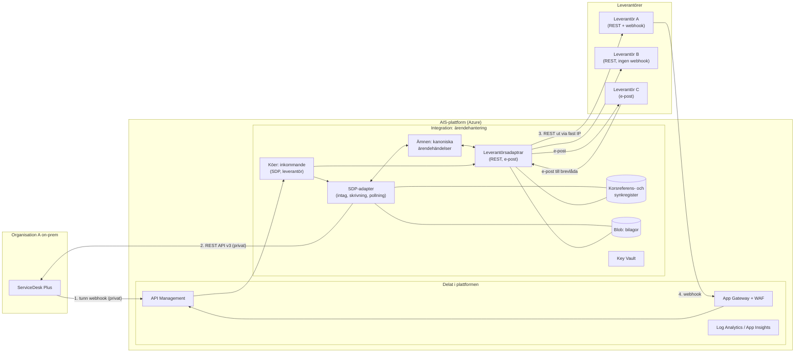
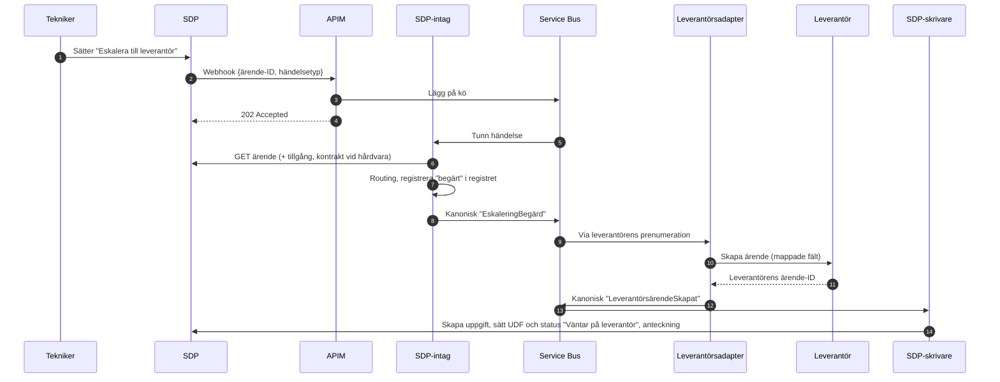
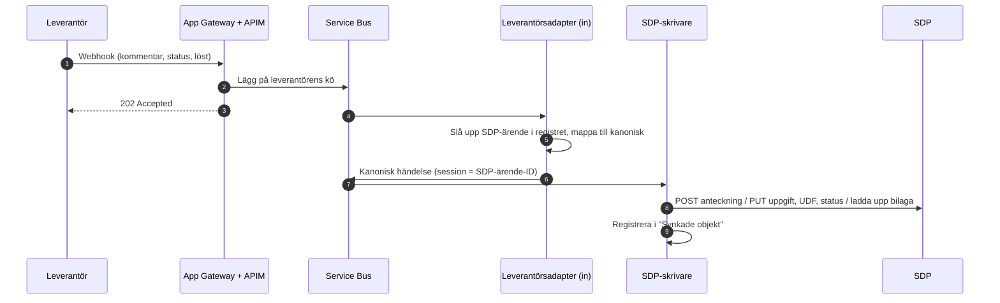

# Integrationslager för ärendeintegration SDP ↔ leverantörer – skiss på AIS

**Organisation:** Organisation A – IT-avdelningens service desk
**Datum:** 2026-11-26
**Status:** Skiss för diskussion (inte färdig lösningsdesign)
**Bygger på:** [`sdp-api-rapport.md`](sdp-api-rapport.md) (användningsfall UC1–UC12, brister B1–B14)

---

## 1. Sammanfattning

Integrationslagret byggs som **en integration bland flera** i en generell plattform på Azure Integration Services (AIS). Det återanvänder plattformens delade byggstenar (API Management, Service Bus, övervakning, nätverk) och lägger till egna komponenter i en egen resursgrupp.

Huvuddragen:

1. **SDP skickar tunna händelser** ("ärende 4711 har ändrats") via webhook till API Management. APIM lägger händelsen på en kö och svarar direkt. Integrationslagret hämtar sedan hela ärendet via SDP:s REST-API.
2. **En kanonisk ärendemodell och publicera/prenumerera** via Service Bus. En *SDP-adapter* och en *adapter per leverantör* översätter till och från den kanoniska modellen. En ny leverantör blir en ny adapter och en ny prenumeration, utan ändringar i SDP-delen.
3. **Ett korsreferensregister** i integrationslagret håller kopplingen mellan SDP-ärende, uppgift och leverantörens ärende-ID, samt vad som redan synkats. Det kompenserar för att SDP saknar en struktur för externa referenser (B7).
4. **Integrationslagret pollar SDP** efter nya anteckningar och bilagor på ärenden som har ett öppet leverantörsärende, eftersom SDP inte kan trigga på dem (B2). En avstämning fångar också webhookar som gått förlorade (B3).
5. **SDP exponeras aldrig mot internet.** Leverantörer anropar plattformens publika API-yta (Application Gateway/WAF → APIM). Bara integrationslagret anropar SDP, över plattformens privata förbindelse till on-prem.

Skissen vilar på antaganden om plattformen (avsnitt 2) och lämnar ett antal frågor öppna (avsnitt 11).

---

## 2. Antagen AIS-plattform

Ingen befintlig plattform är beskriven, så skissen utgår från hur en AIS-plattform vanligen är upplagd, i linje med Microsofts referensarkitekturer ([Basic enterprise integration](https://learn.microsoft.com/en-us/azure/architecture/reference-architectures/enterprise-integration/basic-enterprise-integration), [Enterprise integration using message broker and events](https://learn.microsoft.com/en-us/azure/architecture/example-scenario/integration/queues-events), [Integration Services Landing Zone Accelerator](https://github.com/Azure/Integration-Services-Landing-Zone-Accelerator)).

| Område | Antagande |
|---|---|
| **Nätverk** | Hub-and-spoke. Hubben har ExpressRoute eller site-to-site-VPN till Organisation A:s on-prem-nät, Azure Firewall (eller NAT Gateway) med fast utgående IP samt privat DNS. Integrationsplattformen ligger i ett eget spoke-nät. |
| **API-yta** | Ett delat **API Management** (APIM) i internt VNet-läge. Publika API:er exponeras via **Application Gateway med WAF**. Interna konsumenter (t.ex. SDP on-prem) når APIM privat. |
| **Meddelandehantering** | Ett delat **Service Bus**-namnområde (Premium, med privata slutpunkter) där varje integration äger sina köer och ämnen. **Event Grid** finns för händelsedistribution men behövs inte här. |
| **Exekvering** | **Logic Apps Standard** för orkestrering och adaptrar, **Azure Functions** för logik som blir klumpig i arbetsflöden. Båda med VNet-integration. En Logic App Standard-resurs per integrationsdomän. |
| **Hemligheter och identitet** | **Key Vault** per integration. **Hanterade identiteter** mellan Azure-resurser, inga anslutningssträngar. |
| **Övervakning** | Delad **Log Analytics** och **Application Insights**, gemensamt korrelations-ID, larm via Azure Monitor till plattformens driftteam. |
| **Leverans** | Infrastruktur som kod (Bicep eller Terraform), CI/CD-pipelines, miljöerna *dev*, *test* och *prod*. |
| **Ansvar** | Ett plattformsteam äger delade resurser, namnstandard och mönster. Varje integration äger sina egna arbetsflöden, köer, mappningar och konfiguration. |

Om plattformen i verkligheten avviker (t.ex. saknar privat förbindelse till on-prem, eller har Service Bus Standard) påverkas främst avsnitt 6 och 8.

---

## 3. Designprinciper

| # | Princip | Motiv |
|---|---|---|
| P1 | **SDP är master** för verksamhetens ärende. Leverantörens ärende speglas som en uppgift per leverantörsärende. | Rapporten avsnitt 7.1, B7 |
| P2 | **Så lite logik som möjligt i SDP.** SDP signalerar att något hänt. Routing, mappning, omförsök och leverantörskännedom ligger i integrationslagret. | B1, B3, B11, B14. Triggerkonfigurationen i SDP blir oberoende av antalet leverantörer. |
| P3 | **Tunna händelser, hämta sedan.** Webhooken bär bara ärende-ID och händelsetyp. Aktuellt läge hämtas via API. | Okänslig för ordning och dubbletter, och för formatändringar i webhookens variabler (B13). |
| P4 | **Asynkront och kö-buffrat överallt.** Inget anrop går synkront SDP → leverantör. | B3. En leverantör som ligger nere påverkar varken SDP eller andra leverantörer. |
| P5 | **Kanonisk modell + adapter per system.** | Ny leverantör utan ändring i befintliga flöden. |
| P6 | **Idempotens och ekoskydd.** Varje meddelande kan levereras flera gånger utan dubbla ärenden eller kommentarer. Ändringar som integrationen själv skrivit skickas inte tillbaka. | B2 (polling), brist i UC2 (ingen unikhetskontroll), risk för loopar. |
| P7 | **Fel ska synas för teknikern i SDP**, inte bara i Azure. | Service desk arbetar i SDP, inte i Azure-portalen. |
| P8 | **Återanvänd plattformen.** Inga egna instanser av APIM, Service Bus eller Log Analytics. | Uppgiftens förutsättning. |

---

## 4. Översikt



---

## 5. Komponenter

### 5.1 Delade plattformskomponenter som används

| Komponent | Användning i den här integrationen |
|---|---|
| **APIM** | Två API:er. `arende-sdp-events` (internt): tar emot SDP:s webhookar. `arende-leverantor-events` (publikt via App Gateway): tar emot leverantörers webhookar, en operation per leverantör. Policyer autentiserar, validerar storlek och schema, sätter korrelations-ID, **lägger meddelandet på Service Bus med hanterad identitet** och svarar `202 Accepted`. Ingen affärslogik i APIM. |
| **App Gateway/WAF** | Publik ingång för leverantörer. TLS, WAF-regler, vid behov IP-filter per leverantör. |
| **Service Bus-namnområdet** | Integrationens köer och ämnen (5.3). |
| **Log Analytics/App Insights** | Loggning, spårning och larm (avsnitt 9). |
| **Hubbnätet** | Privat väg till SDP on-prem och fast utgående IP mot leverantörer. |

### 5.2 Integrationens egna komponenter

Allt nedan ligger i integrationens resursgrupp, t.ex. `rg-int-arendehantering-<miljö>`.

| Komponent | Tjänst | Ansvar |
|---|---|---|
| **SDP-intag** | Logic Apps Standard (arbetsflöde) | Läser tunn händelse från kön. Hämtar ärendet från SDP (`GET /api/v3/requests/{id}`). Filtrerar bort eko (5.5). Avgör leverantör via routingtabell. Jämför mot senast synkat läge. Publicerar kanonisk händelse. |
| **SDP-skrivare** | Logic Apps Standard | Prenumererar på leverantörshändelser. Skriver till SDP: anteckning, uppgiftsstatus, UDF, ärendestatus, bilagor, lösning. Ett anrop i taget per ärende (sessioner). |
| **SDP-pollare** | Logic Apps Standard (tidsstyrt) | (a) Hämtar nya anteckningar och bilagor på ärenden med öppet leverantörsärende enligt registret. (b) Avstämning: söker ärenden som ändrats sedan senaste vattenstämpel och jämför mot registret, för att fånga förlorade webhookar. |
| **Leverantörsadapter (REST)** | Logic Apps Standard, ett arbetsflöde per leverantör och riktning | Ut: kanonisk händelse → leverantörens API (skapa, uppdatera, kommentera, stänga, ladda upp bilaga). In: leverantörens webhook, eller pollning om webhook saknas → kanonisk händelse. |
| **Leverantörsadapter (e-post)** | Logic Apps Standard med Office 365 Outlook-anslutning | Ut: formaterad e-post från en dedikerad delad brevlåda per leverantör, med integrationens referens i ämnesraden. In: läser brevlådan, matchar referens, filtrerar autosvar, publicerar kanonisk händelse. |
| **Mappningsfunktioner** | Azure Functions (vid behov) | Mappning som är för komplex för arbetsflödets inbyggda verktyg, t.ex. HTML ↔ leverantörens textformat, och strömmande överföring av stora bilagor. |
| **Korsreferens- och synkregister** | Azure Table Storage (eller Azure SQL om rapportbehov finns) | Se 5.4. |
| **Bilagelager** | Blob Storage | Tillfällig lagring av bilagor enligt mönstret [claim check](https://learn.microsoft.com/en-us/azure/architecture/patterns/claim-check). Automatisk radering efter några dagar. |
| **Key Vault** | Key Vault | SDP:s authtoken, leverantörers API-nycklar och klienthemligheter. |
| **Konfiguration** | Appinställningar och konfigurationstabell | Per miljö: SDP:s bas-URL, UDF-fältnamn (`udf_sline_NNN` skiljer mellan miljöer, UC2), statusnamn. Per leverantör: routingregler, värdemappningar (prioritet, status, kategori), adresser. |

Varför Logic Apps Standard som bas: plattformens förmodade standardval, färdiga anslutningar för Service Bus och Outlook, inbyggd körhistorik som hjälper felsökning, och möjlighet till VNet-integration. Varje leverantörsadapter är ett eget arbetsflöde i samma Logic App-resurs och kan driftsättas och stängas av separat.

### 5.3 Köer och ämnen

| Namn (exempel) | Typ | Innehåll | Avsändare → mottagare |
|---|---|---|---|
| `sbq-arende-sdp-inkommande` | Kö | Tunna händelser från SDP | APIM → SDP-intag |
| `sbq-arende-lev-inkommande-<leverantör>` | Kö per leverantör | Leverantörens webhook, obearbetad | APIM → leverantörsadapter (in) |
| `sbt-arende-till-leverantor` | Ämne | Kanoniska händelser från SDP | SDP-intag, SDP-pollare → en prenumeration per leverantör med filter på `leverantorId` |
| `sbt-arende-fran-leverantor` | Ämne | Kanoniska händelser från leverantörer | Leverantörsadaptrar → SDP-skrivare (och ev. framtida prenumeranter, t.ex. uppföljning för UC12) |

Inställningar som bär designen:

- **Sessioner** med SDP:s ärende-ID som sessionsnyckel ger ordning per ärende och hindrar parallella skrivningar mot samma ärende ([Message sessions](https://learn.microsoft.com/en-us/azure/service-bus-messaging/message-sessions)).
- **Dubblettdetektering** på `MessageId` (t.ex. `<ärende-ID>:<händelsetyp>:<objekt-ID eller ändringstid>`) tar bort upprepade webhookar och överlapp mellan webhook och pollning ([Duplicate detection](https://learn.microsoft.com/en-us/azure/service-bus-messaging/duplicate-detection)).
- **Omförsök och dead letter-kö.** Tillfälliga fel ger omförsök med ökande väntetid. Efter maximalt antal försök hamnar meddelandet i dead letter-kön, vilket larmar och skriver tillbaka ett fel till SDP (avsnitt 9).

### 5.4 Korsreferens- och synkregister

Registret är integrationens minne och kompenserar B2 och B7.

| Tabell | Nyckel | Innehåll |
|---|---|---|
| **Leverantörsärende** | SDP-ärende-ID + leverantör + löpnummer | SDP-uppgiftens ID, leverantörens ärende-ID och länk, leverantörens senaste status, tillstånd (*begärt, skapat, löst, stängt, fel*), tidsstämplar (skapat, första svar, löst – underlag för UC6 och UC12), kontrollsumma över senast synkade fält |
| **Omvänd uppslagning** | Leverantör + leverantörens ärende-ID | SDP-ärende-ID. Används när leverantören bara skickar sitt eget ID. Ersätter sökning på UDF i SDP och ger unikhetskontroll. |
| **Synkade objekt** | SDP-ärende-ID + objekttyp + objekt-ID | Anteckningar och bilagor som redan skickats eller tagits emot, med riktning och motpartens ID. Ger idempotens och ekoskydd. |
| **Vattenstämplar** | Pollare | Senaste lyckade pollningstid |

Leverantörens ärende-ID skrivs **också** till SDP (uppgiftens titel/beskrivning och UDF på ärendet) så att tekniker kan se och söka på det. Registret är dock källan som integrationen litar på.

### 5.5 Ekoskydd

När integrationen skriver till SDP (t.ex. sätter UDF *Leverantörsstatus*) utlöser det SDP:s trigger *Request edited*, som skickar en webhook tillbaka. Tre skydd, i lager:

1. **Villkor i SDP:s trigger:** skicka inte om ändringen gjordes av integrationsteknikern. (Verifiera att triggervillkor kan uttrycka det.)
2. **SDP-intag jämför** hämtat ärende mot kontrollsumman i registret. Ingen relevant skillnad → ingen händelse.
3. **Anteckningar och bilagor** som integrationen själv skapat finns i tabellen *Synkade objekt* och hoppas över av pollaren.

---

## 6. Flöden

### 6.1 Eskalera till leverantör (UC1, UC2)



Kommentarer:

- Steg 7: posten i registret skapas **innan** anropet till leverantören. Vid omförsök ser adaptern att ärendet redan är begärt och kan, om leverantörens API stöder det, skicka med en idempotensnyckel eller först söka efter ett befintligt ärende med SDP-referensen. Det skyddar mot dubbla leverantörsärenden.
- Routing (steg 7) sker i första hand på det teknikern valt i fältet. Routingtabellen kan senare utökas med förslag utifrån kategori eller tillgångens kontrakt (B11, UC10).
- Teknikern kan alltid välja en leverantör som bara har e-postadapter. Flödet är detsamma fram till steg 10.

### 6.2 Uppdateringar från SDP till leverantören (UC3, UC5)

- **Fältändringar** (prioritet, status m.m.): samma väg som 6.1. SDP-intag avgör utifrån registret att ärendet har ett öppet leverantörsärende och publicerar `ÄrendeUppdaterat` med de fält som ändrats.
- **Anteckningar och bilagor:** SDP-pollaren går med några minuters intervall igenom ärenden med öppet leverantörsärende, hämtar anteckningar (`GET .../notes`) och bilagelistan, och publicerar `KommentarTillagd` respektive `BilagaTillagd` för objekt som saknas i *Synkade objekt* och som är märkta för leverantören.
- **Märkning:** SDP skiljer inte på interna anteckningar och anteckningar till leverantör (UC3). Skissens förslag är en enkel konvention, t.ex. att anteckningen inleds med `@leverantör` (eller `@<leverantörsnamn>` när flera är inblandade). Allt annat stannar internt. Det är säkrare än att skicka allt, eftersom interna anteckningar kan innehålla känsliga uppgifter. Alternativet är en *Custom Menu*-knapp i SDP som skickar en händelse direkt. Se öppen fråga F3.
- **Bilagor** hämtas från SDP till Blob Storage. Meddelandet på bussen bär bara en referens. Leverantörsadaptern laddar upp filen till leverantören, eller bifogar den i e-post upp till en storleksgräns.

### 6.3 Uppdateringar från leverantören till SDP (UC4, UC5, UC9)



Varianter på ingången, per leverantör:

| Leverantörens förmåga | Ingång |
|---|---|
| Skickar webhookar | App Gateway → APIM → kö (som ovan) |
| Har API men inga webhookar | Tidsstyrt arbetsflöde i adaptern pollar leverantörens API för öppna ärenden enligt registret |
| Bara e-post | Adaptern läser den delade brevlådan. Referensen i ämnesraden matchas mot registret. Brev utan träff går till manuell hantering (vidarebefordras till service desk). |

Vad SDP-skrivaren gör med respektive händelse:

| Kanonisk händelse | Åtgärd i SDP |
|---|---|
| `KommentarTillagd` | Anteckning på ärendet, märkt med leverantör och leverantörens ärende-ID, `show_to_requester = false` |
| `StatusÄndrad` | Uppdatera UDF *Leverantörsstatus* och uppgiftens status |
| `InformationBegärd` | Som ovan, samt ärendestatus från *Väntar på leverantör* till *Pågående* så att SLA-klockan går och teknikern ser att bollen är hos IT |
| `LeverantörsärendeLöst` | Stäng uppgiften, anteckning med leverantörens lösningstext, ärendestatus till *Pågående*. **Ärendet stängs inte automatiskt** – IT verifierar (UC9). |
| `BilagaTillagd` | Ladda upp bilagan till ärendet och skriv en anteckning som anger filnamnet (B8) |

### 6.4 Avslut och återöppning (UC9)

- Ärendet stängs i SDP → trigger → `ÄrendeStängt` → adaptern stänger eller bekräftar leverantörens ärende, om det fortfarande är öppet.
- Leverantören återöppnar eller SDP-ärendet återöppnas → motsvarande händelse åt andra hållet. Registrets tillstånd avgör om det är en giltig övergång.
- Att SDP inte låter ett ärende stängas medan leverantörsärenden är öppna löses i SDP (öppen uppgift blockerar stängning, eller Request Life Cycle), inte i integrationslagret.

### 6.5 Flera leverantörer och storstörning (UC7, UC8)

- **Flera leverantörer på ett ärende:** en uppgift och en registerpost per leverantörsärende. Ämnets prenumerationsfilter ser till att varje leverantör bara får sina händelser.
- **Storstörning:** leverantörsärendet kopplas till huvudärendet. SDP-skrivaren sätter `add_to_linked_requests` på anteckningar när det är konfigurerat. Länkningen av ärenden görs av tekniker i SDP tills API-stödet är verifierat (B9).

---

## 7. Kanonisk ärendemodell (utkast)

Ett kuvert med gemensamma fält och en händelsespecifik del. Fältnamnen är förslag.

```json
{
  "handelseId": "c0a8…",
  "handelsetyp": "EskaleringBegärd",
  "tidpunkt": "2026-11-26T09:14:03Z",
  "korrelationsId": "…",
  "kalla": "SDP",
  "leverantorId": "leverantor-a",
  "sdp": { "arendeId": "4711", "uppgiftId": null },
  "leverantor": { "arendeId": null, "url": null },
  "arende": {
    "rubrik": "Server SRV-042 startar inte",
    "beskrivning": "…",
    "prioritet": "Hög",
    "paverkan": "Avdelning",
    "kategori": "Hårdvara/Server",
    "kontakt": { "namn": "…", "epost": "…", "telefon": "…" },
    "tillgang": { "namn": "SRV-042", "serienummer": "…", "modell": "…", "avtalsnummer": "…" }
  },
  "kommentar": null,
  "bilaga": null
}
```

- **Händelsetyper:** `EskaleringBegärd`, `ÄrendeUppdaterat`, `KommentarTillagd`, `BilagaTillagd`, `ÄrendeStängt`, `ÄrendeÅteröppnat` (från SDP) samt `LeverantörsärendeSkapat`, `StatusÄndrad`, `InformationBegärd`, `KommentarTillagd`, `BilagaTillagd`, `LeverantörsärendeLöst`, `LeverantörsärendeStängt`, `SynkMisslyckades` (från leverantörssidan).
- **Kanoniska värdelistor** för prioritet och status. Varje adapter mappar mellan kanoniska värden och sitt systems värden via konfiguration, inte kod.
- `leverantorId`, `sdp.arendeId` och `handelsetyp` läggs också som meddelandeegenskaper så att filter och sessioner fungerar utan att läsa innehållet.
- **Dataminimering:** adaptern skickar bara de fält leverantören behöver. Kontaktuppgifter till slutanvändare skickas bara om leverantören ska kontakta användaren direkt.

---

## 8. Nätverk och säkerhet

| Förbindelse | Väg | Autentisering |
|---|---|---|
| SDP → APIM | Privat, via ExpressRoute/VPN till APIM:s interna adress | API-nyckel (APIM-prenumerationsnyckel) i egen header, som SDP:s webhookar har dokumenterat stöd för. Starkare metod (klientcertifikat, OAuth) om SDP:s webhook stöder det – verifieras. |
| Integrationslager → SDP | Privat, VNet-integration → hubb → on-prem. Brandväggsöppning från integrationens subnät till SDP:s API-port. | SDP:s `authtoken` från Key Vault. En **dedikerad integrationstekniker** med minsta möjliga roll (B5). Samma konto oavsett leverantör, eftersom leverantörer aldrig anropar SDP själva. |
| Integrationslager → leverantör | Utgående via hubbens brandvägg, fast publik IP som leverantören kan vitlista | Per leverantör: OAuth 2.0-klientuppgifter, API-nyckel eller klientcertifikat. Hemligheter i Key Vault. |
| Leverantör → APIM | Internet → App Gateway/WAF → APIM | Per leverantör: OAuth 2.0 (Entra ID) eller klientcertifikat i första hand, annars API-nyckel + IP-filter + signaturkontroll av webhooken om leverantören signerar. |
| E-post | Exchange Online, delad brevlåda per leverantör | Anslutning med tjänstekonto eller applikationsbehörighet begränsad till brevlådorna |
| Mellan Azure-resurser | Privata slutpunkter | Hanterad identitet och RBAC |

Övrigt:

- **SDP:s certifikat.** Om SDP använder certifikat från en intern CA måste Logic Apps och Functions lita på den (rotcertifikat läggs in i appen).
- **En integrationstekniker i stället för en per leverantör** minskar licensbehovet jämfört med rapportens farhåga i UC4, men gör att SDP:s historik inte skiljer leverantörerna åt. Anteckningar märks därför med leverantörens namn.
- **Personuppgifter och känslig information.** Ärenden innehåller personuppgifter och kan innehålla säkerhetskänsliga detaljer om Organisation A:s miljö. Att SDP valts som on-prem-lösning tyder på krav kring var data får finnas. Skissen förutsätter att ärendedata får passera Azure (region inom EU, t.ex. Sweden Central). Meddelanden lagras bara tillfälligt (köer, Blob med automatisk radering). Loggar innehåller metadata och ID:n, inte ärendetext. Se öppen fråga F1.

---

## 9. Felhantering och övervakning

| Situation | Hantering |
|---|---|
| Leverantörens API svarar inte | Omförsök med ökande väntetid. Meddelandet ligger kvar i prenumerationen. Övriga leverantörer påverkas inte. |
| Bestående fel (ogiltigt fält, behörighet nekad) | Dead letter-kö → larm till plattformens drift → `SynkMisslyckades` publiceras → SDP-skrivaren sätter UDF *Synkstatus = Fel* och skriver en anteckning med begriplig feltext (P7). |
| SDP ligger nere | Händelser från leverantörer köas och skrivs när SDP är tillbaka. Sessioner bevarar ordningen. |
| APIM eller förbindelsen nere när SDP skickar webhook | Webhooken går förlorad (B3). Pollarens avstämning hittar ärendet inom ett intervall. |
| Dubbla webhookar, överlapp mellan webhook och pollning | Dubblettdetektering och registret |
| Leverantörsuppdatering för okänt ärende-ID | Går till en avvikelsekö och larmar. Skrivs inte till SDP. |
| Behov att köra om | Meddelanden i dead letter-kö kan skickas om efter rättning. Logic Apps körhistorik visar var det gick fel. |

Övervakning:

- **Korrelations-ID** sätts i APIM (eller av pollaren) och följer med i alla steg och loggar.
- **Spårade egenskaper** i Logic Apps: SDP-ärende-ID, leverantör, leverantörens ärende-ID, händelsetyp. Det gör att man i Log Analytics kan söka fram allt som hänt med ärende 4711.
- **Larm:** meddelanden i dead letter-kö, köålder över tröskel, misslyckade körningar, pollaren har inte kört, authtoken eller certifikat närmar sig utgångsdatum.
- **Arbetsbok eller instrumentpanel** per integration enligt plattformens mall.

---

## 10. Driftsättning och utbyggnad

- **Miljöer:** dev, test, prod i Azure. Test kopplas mot SDP:s testinstans och leverantörernas testmiljöer där de finns. UDF-namn och statusnamn är konfiguration per miljö.
- **Kodförråd och pipelines:** arbetsflöden, mappningar, APIM-definitioner och infrastruktur som kod i samma förråd, driftsatta via plattformens pipelines.
- **Regressionstest** mot SDP:s API körs före uppgradering av SDP (B13). Eftersom SDP-åtkomsten är samlad i SDP-adaptern påverkas bara den.
- **Lägga till en leverantör:** (1) ny adapter (arbetsflöden ut och in), (2) ny prenumeration på `sbt-arende-till-leverantor`, (3) vid webhook: ny operation i APIM och ny kö, (4) hemligheter i Key Vault, (5) rad i routing- och mappningskonfigurationen, (6) nytt värde i SDP-fältet *Leverantör*. Inga ändringar i SDP:s triggers eller i SDP-adaptern.

Förslag till etappindelning:

| Etapp | Innehåll | Syfte |
|---|---|---|
| 0 | Verifiera punkterna i rapportens avsnitt 7.2 mot SDP:s testinstans, plus F1–F2 nedan | Undanröja antaganden |
| 1 | SDP-adapter, register, en leverantör med REST-API: UC1, UC2, UC4 (kommentarer, status), UC9 | Bevisa hela kedjan åt båda håll |
| 2 | Anteckningar och bilagor från SDP (pollning), felåterkoppling till SDP | UC3, UC5 |
| 3 | E-postadapter, fler leverantörer, flera leverantörer per ärende | Bredd |
| 4 | Tidsstämplar och uppföljning av leverantörsprestation, berikning med tillgång och kontrakt | UC6, UC10, UC12 |

---

## 11. Öppna frågor

| # | Fråga | Påverkar |
|---|---|---|
| F1 | Får ärendedata (personuppgifter, uppgifter om IT-miljön, bilagor) passera och tillfälligt lagras i Azure? Finns klassning som kräver annat? | Hela upplägget. Vid nej behövs en on-prem-placerad variant, vilket går utanför AIS-antagandet. |
| F2 | Har AIS-plattformen privat förbindelse till on-prem-nätet där SDP står? Om inte: Hybrid Connections eller on-premises data gateway för anrop till SDP, och SDP:s webhook måste gå ut mot internet till APIM. | Avsnitt 8 |
| F3 | Hur ska tekniker märka anteckningar och bilagor som ska till leverantören: textkonvention (`@leverantör`) eller Custom Menu-knapp? Bör provas med service desk. | 6.2 |
| F4 | Vilket pollningsintervall är acceptabelt för anteckningar (förslag: 2–5 minuter)? | 6.2, belastning på SDP |
| F5 | Kan SDP:s triggervillkor utesluta ändringar gjorda av integrationsteknikern? Annars vilar ekoskyddet helt på integrationslagret. | 5.5 |
| F6 | Vilka leverantörer ska med först, och vad kan deras system (rapportens avsnitt 7.3)? | Etapp 1 och 3 |
| F7 | Ska uppföljningsdata (UC12) tas från registret, från SDP:s rapporter eller från ett datalager? | Val av lagring för registret (Table Storage eller SQL) |
| F8 | Räcker Service Bus-nivån i plattformen (sessioner och dubblettdetektering finns i Standard och Premium, privata slutpunkter bara i Premium)? | 5.3 |

---

## 12. Hur skissen möter rapportens brister

| Brist | Hantering i integrationslagret |
|---|---|
| B1 Ingen e-bonding | Hela lagret: kanonisk modell, adaptrar, register |
| B2 Ingen trigger på anteckningar och bilagor | SDP-pollaren (5.2, 6.2) |
| B3 Webhook utan omförsök | APIM + kö direkt, avstämning via pollning (P3, P4, avsnitt 9) |
| B4 Ingen inkommande webhook i SDP | Leverantörer anropar APIM. Bara integrationslagret anropar SDP. |
| B5 Teknikerbunden authtoken | En integrationstekniker med minimal roll, nyckel i Key Vault, larm före utgång |
| B6 Ingen leverantörs-SLA | Tidsstämplar i registret och i UDF som underlag. Mätningen i sig är inte löst av skissen. |
| B7 Ingen struktur för externa referenser | Registret + en uppgift per leverantörsärende |
| B8 Bilagor utan koppling till anteckning | Claim check via Blob, anteckning som anger filnamn |
| B9 Länkning via API oklar | Länkning görs manuellt i SDP tills verifierat |
| B10 Ofullständig dokumentation | All SDP-åtkomst samlad i SDP-adaptern, verifiering i etapp 0 |
| B11 Inget leverantörsregister kopplat till ärenden | Routing- och mappningskonfiguration |
| B12 Bräcklig e-post mellan ärendesystem | E-post går via integrationens brevlådor och adapter, inte via SDP:s e-posthantering |
| B13 Formatändringar mellan byggen | Tunna händelser, SDP-adapter som enda beröringspunkt, regressionstest |
| B14 Execute Script på SDP-servern | Behövs inte. SDP gör bara ett webhook-anrop. |
